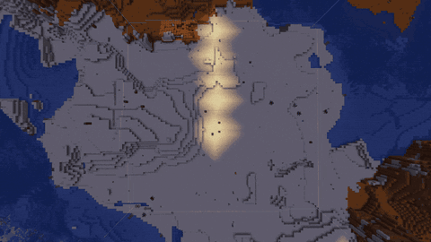
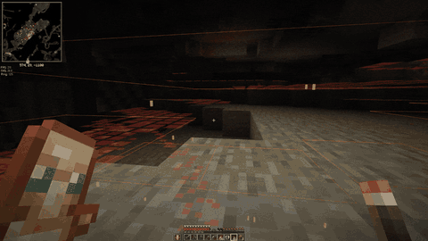
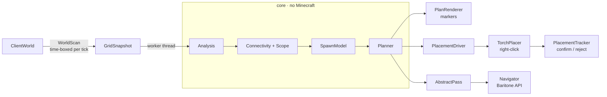

<div align="center">

**English** | [Русский](README_RU.md)

# 🔥 Torch Automation

**Light up your base — and never wonder where the next creeper came from.**

A free [Meteor Client](https://meteorclient.com) addon for Minecraft **1.21.1** that works out *exactly* where torches are needed to stop mobs spawning in the dark, then places them for you.


### [⬇️ Download the latest release](https://github.com/ZederBreys/AdentikaTorch/releases/latest)



<sub>Torches Around: start it, step back, and the area lights up evenly — no gaps, no wasted torches.</sub>

</div>

---

## Why Torch Automation?

Spamming torches on a grid wastes a stack and still leaves dark corners. Torch Automation works the other way round: it reads the real light in the world, finds every block where a monster could actually spawn, and plans the **fewest torches that cover all of them**.

- 💡 **Counts the light you already have.** Lamps, lava and torches you placed earlier are all taken into account — a torch is never placed where everything is already lit.
- 🍃 **Skips blocks mobs can't spawn on.** Leaves, glass, slabs, carpets and similar blocks are left alone. The game's own spawn checks decide this, not a hard-coded list.
- 🧠 **Knows whether you're underground.** On the surface it lights the ground around you. In a cave it switches to cave mode by itself: it sticks to the cave you're in, scans a taller area and prefers wall torches.
- 🧱 **Uses any surface that works.** Floors, walls, furnaces, crafting tables, barrels… On blocks that would open when clicked, it sneaks so no menu pops up.
- 🕳️ **Leaves closed mines alone.** Only spaces connected to you by air count, so a sealed tunnel under your feet doesn't get torches.
- ✋ **Plays fair.** Every torch is placed by a normal right-click, only within arm's reach and in direct line of sight. A slower *Legit* mode is there for strict servers.
- 👀 **You always see what's going on.** Dark spots, planned torches and the next target are drawn in the world. Progress shows in chat and in the module list.
- ⏯️ **Fully under your control.** Nothing ever starts on its own. Pause, resume or cancel at any time. Progress is saved, so a long job continues after a restart.

## Five ways to light things up

| Module | What it does |
|---|---|
| 🌍 **Torches Around** `torch-around` | Lights the area around you without any selection. The mod walks with Baritone and places torches until everything within the radius is lit: 42 blocks by default, up to 200. Works in caves too. |
| ⛏️ **Torch Escort** `torch-escort` | You explore, and the mod places torches along the way. Made for mines and caves. |
| 📐 **Torch Pass** `torch-pass` | Select an area and the mod walks through it, part by part, until it's fully lit. Handles areas up to 512 × 512 by default (`max-size`). |
| 🔍 **Torch Highlight** `torch-highlight` | Shows dark spots, chunks with dark spots and the recommended torch positions. Places nothing. |
| 🗺️ **Torch Area** `torch-area` | Select an area with two clicks and see how many torches it needs, compared with how many you carry. |

## ⛏️ Torch Escort — never mine in the dark again

Turn it on and just keep mining. Torch Escort lights the tunnel around you as you go: each torch lands exactly where it's needed, only within reach, and the camera snaps back afterwards so you hardly notice.

<div align="center">

</div>

Red squares are spots where monsters can spawn. Watch them disappear as the torches go in.

## 🌐 Speaks your language

All chat messages are available in:

- 🇬🇧 **English**
- 🇷🇺 **Русский**

The language follows your Minecraft language setting automatically.

## 🚀 Get started

**You need:** Minecraft Java **1.21.1** with [Fabric Loader](https://fabricmc.net/use/), **[Meteor Client 0.5.8](https://meteorclient.com)**, and **Baritone** for the walking modes (Torches Around and Torch Pass).

1. Download `torch-automation-<version>.jar` from the [latest release](https://github.com/ZederBreys/AdentikaTorch/releases/latest) or [build it yourself](#building).
2. Put it into your `mods` folder next to Meteor Client.
3. Open the Meteor menu (**Right Shift**). The modules are in the **Torch** category.
4. Keep torches in your hotbar or offhand, then turn on a module or type a command:

```
.torcharound start        light everything around you (radius 42)
.torcharound start 80     ...or pick your own radius
.torcharound preview      show the area border first
.torcharea start          walk through your selected area
```

> [!NOTE]
> Torches stop **darkness-based** spawns in the Overworld. They don't affect spawners, special structures (such as Ocean Monuments, Nether fortresses or Witch Huts), pillager patrols, or mobs walking in from unlit areas. Slimes in swamps need more light (profile `SWAMP_SLIMES`).

> [!WARNING]
> Many multiplayer servers forbid automation. Use the mod only where it's allowed.

---

# 🛠️ Technical documentation

The rest of this file is for developers and curious players. It describes how the addon works inside.

- [Architecture](#architecture)
- [Project layout](#project-layout)
- [Analysis pipeline](#analysis-pipeline)
- [Spawn and light model](#spawn-and-light-model)
- [Torch planner](#torch-planner)
- [Surface vs. cave detection](#surface-vs-cave-detection)
- [Where a torch can go](#where-a-torch-can-go)
- [Placing torches: Escort and the placement driver](#placing-torches-escort-and-the-placement-driver)
- [Auto passes: Torch Pass and Torches Around](#auto-passes-torch-pass-and-torches-around)
- [Block rules](#block-rules)
- [Localization](#localization)
- [Commands and settings](#commands-and-settings)
- [Building](#building)
- [Releasing](#releasing)

## Architecture

The project is split into two Gradle modules:

- **`core`** is plain Java 21 with **no Minecraft classes**: the light simulation, spawn model, planner, connectivity, tiling and block rules. It is fully unit-tested with JUnit 5 and does not depend on the game version.
- **The addon** (`src/main`) is a thin adapter layer. It reads the world into a `GridSnapshot`, runs the core, renders the result, clicks, and drives Baritone.



Code that depends on a particular Minecraft version is isolated in `mc/`: `WorldScan`, `TraitsProvider` and `TorchPlacer` talk to the game, `Navigator` is the only class that imports Baritone. Without Baritone installed, the walking modes report that it is missing and everything else keeps working.

## Project layout

```
core/src/main/java/adentika/torch/core/
  GridSnapshot      compact world cuboid: flags, block light, opacity, emission, faces
  LightSim          block-light propagation with 1.21.1 engine rules
  SpawnModel        dark spawnable cells per light profile
  Scope             analysis bounds: box/window, air connectivity, max depth
  Connectivity      air flood fill from one or many seeds
  Planner           greedy set-cover torch planner
  PlacementTracker  click → confirmed / rejected bookkeeping
  TileGrid          16×16 tiles, states, walk order, (de)serialisation
  blocks/           BlockTraits, Category, CategoryResolver, Hazard
src/main/java/adentika/torch/
  TorchAutomationAddon   Meteor entry point: category, modules, commands
  mc/       WorldScan, TraitsProvider, BlockRules, Analysis, PlanRenderer,
            TorchPlacer, PlacementDriver, Navigator, PassStore, Msg
  modules/  TorchHighlight, TorchArea, TorchEscort, AbstractPass,
            TorchPass, TorchAround, TorchBlocks
  commands/ .torcharea, .torcharound, .torchblock
src/main/resources/assets/torch-automation/lang/   en_us.json, ru_ru.json
docs/       product spec, research, decisions, plan, block rules, manual tests
```

## Analysis pipeline

1. **Scan** (`WorldScan`, main thread). Fills a `GridSnapshot` cell by cell under a time budget: 3 ms per client tick by default (`budget-ms`). A large area therefore never freezes the game. Unloaded chunks are marked `UNKNOWN`. Unknown cells are never treated as safe and never pass light.
2. **Analyse** (`Analysis`, single worker thread). Builds the `Scope`, finds dark spawnable cells (`SpawnModel`) and plans torches (`Planner`). It also groups dark spots per chunk for the chunk overlay.
3. **Show and act.** `PlanRenderer` draws spots, chunks and torch markers. The placing modes feed the plan to `PlacementDriver`.

Highlight rescans after you move `rescan-distance` blocks, when a block inside the snapshot changes, and every `refresh-seconds`, since light can change without block updates. Recommendations from the previous plan that are still useful and lie in the interior of the area are kept. Because of this, markers don't jump around while you walk.

## Spawn and light model

- **Safe = block light ≥ 1** in the mob's feet cell (profile `MONSTERS`). In the Overworld, any block light blocks the darkness check of hostile mobs in 1.21.1. Sky light is never used as "safe", because night and weather change it. Two more profiles exist: `SWAMP_SLIMES` (≥ 8) and `PATROLS` (≥ 9).
- **Can a mob spawn here?** This is answered with vanilla methods, not a block list:
  - `SpawnRestriction.isSpawnPosAllowed` checks the floor and placement rules;
  - `isSpaceEmpty(type.getSpawnBox(...))` checks the hitbox.

  Three probes with different hitboxes are used: zombie, spider and enderman.
- **Biomes.** Mushroom Fields and Deep Dark have no natural monster spawns. The client only receives biomes without their spawn lists, so these two are recognised by biome key. They can be included with `include-no-monster-biomes`.
- **Light simulation** (`LightSim`) follows `ChunkBlockLightProvider`. A step into a neighbour costs `max(1, opacity)`. It is blocked if the source face or the neighbour face that blocks light is full, which handles slabs, stairs and similar blocks.
- **Untrusted light.** Light from sources that can switch off (furnaces, lamps, candles, campfires…) does not count as protection by default (`distrust-variable-light`). In that case light is re-propagated from stable sources only.

## Torch planner

`Planner` is a deterministic **greedy set cover**:

1. Every cell where a torch could stand becomes a candidate. Its *coverage* is the set of dark cells its own light (level 14) would raise to the safe level. Cells that are already lit are never dark, so a torch next to existing light gains nothing and is never chosen.
2. Two heuristics run independently:
   - **max-gain** is a lazy priority queue that always picks the torch covering the most uncovered cells;
   - **rarest-first** takes the cell with the fewest candidates first, which handles edges and corners better.
3. Each result goes through **redundancy pruning**: torches whose cells are all covered by others are removed. The plan with fewer torches wins.
4. In cave mode, wall torches win ties.

The result is close to minimal but not guaranteed optimal. Dark cells that no candidate can reach (roofs, ledges) are reported as *uncoverable*. In the placing modes, only candidates within reach of a standable, air-connected cell are used.

## Surface vs. cave detection

- The surface height of a column is taken from the client heightmap `MOTION_BLOCKING`. From there it goes down past leaves and blocks without collision (water, grass, flowers).
- In **Auto** mode you are *underground* when your feet are at least `auto-cave-depth` blocks (default 6) below that surface. The mode is re-evaluated on each scan, and a switch is announced in chat.

| | Surface | Cave |
|---|---|---|
| Vertical window | 6 down / 8 up | 24 down / 16 up |
| Max depth below surface | 3 (`limit-depth`) | not limited |
| Air connectivity to you | on | on |
| Torch preference | floor | wall |
| Baritone (walking modes) | may break/place to get through | walks only (`allow-digging-in-caves`) |

**Air connectivity** (`Connectivity`) is a flood fill through passable cells, starting from your feet. Only reached cells are in scope, which is why a sealed mine under your feet is ignored.

## Where a torch can go

For every passable, replaceable, fluid-free cell, `WorldScan` asks the game itself:

- **Floor torch:** `Blocks.TORCH.canPlaceAt(...)`, and the block below must have a solid enough top centre.
- **Wall torch:** `Blocks.WALL_TORCH` facing each horizontal direction, checked with `canPlaceAt(...)`. The supporting side must be a full solid square.

The block rules then filter the support (see [Block rules](#block-rules)). For example, leaves and scaffolding are not used by default because they can disappear. Sand and gravel are allowed, otherwise a desert couldn't be lit. Interactive blocks are marked so that the placer sneaks before clicking them; `TraitsProvider.isInteractive` covers containers, doors, crafting stations and so on.

## Placing torches: Escort and the placement driver

`TorchPlacer` makes one ordinary click:

- **Reach.** A ray from the eyes along the *exact* look direction, as long as `getBlockInteractionRange() − 0.1`, must hit the supporting face. Nothing is clicked beyond arm's length or through blocks.
- **Look first, click later.** The camera turns in `TickEvent.Pre`, and the click happens in `TickEvent.Post` through `interactionManager.interactBlock`. By then the server already has the new look direction.
- **Torches** come from the hotbar or offhand only. Sneak is pressed only for interactive supports and released afterwards, unless you are holding the key yourself.

`PlacementDriver` runs the clicks in one of two modes:

| Mode | Behaviour |
|---|---|
| **Aggressive** (default) | Several torches in a row, one click every `fast-delay-ticks`. Confirmations are checked in parallel. |
| **Legit** | One torch at a time: it waits for the server's answer and a fresh scan before the next one. |

`PlacementTracker` treats a click as a *request*. A torch counts as placed only if it is still in the world once the server has had time to answer. A position rejected twice is skipped. After `max-failures` rejections in a row the module stops and says why. It also stops when torches run out, when you die, or when you leave the Overworld.

**Torch Escort** uses Torch Highlight's plan and turns Highlight on if needed. While you walk, it places the planned torches that come into reach, then turns the camera back (`restore-view`).

## Auto passes: Torch Pass and Torches Around

Both modules share `AbstractPass`. The region is split into **16 × 16 tiles**, and each tile goes through these steps:

```
PICK → LOAD (walk closer until chunks load) → SCAN (tile + 8-block margin)
     → ANALYZE (plan from reachable, connected spots) → WORK → VERIFY (rescan) → done
```

- **WORK** places whatever is in reach. For everything else, `Navigator` sends Baritone to the nearest remaining torch (`GoalNear`). A torch that still can't be clicked after a closer attempt is marked unreachable and reported at the end. One tile gets up to 3 plan/verify rounds.
- **Walk order** (`TileGrid.todoInWalkOrder`). The next tile is the one nearest to you among those that border finished tiles. Tiles with more finished or edge sides go first, so holes and strips are not left behind.
- **Torches Around** fixes its square and height window at the start point. Air connectivity is carried across tiles in a region-wide bit set: each new tile is flood-filled from cells already reached by its neighbours. A tile that first looked empty is reopened if a winding cave reaches it later.
- **Baritone.** If Baritone is already busy (`#mine`, `#goto`…), the pass refuses to start unless you use `start force`. When digging is forbidden, `allowBreak` and `allowPlace` are switched off for the duration of the pass and then set back to your values.
- **Progress** is saved per world or server and dimension in `.minecraft/meteor-client/torch-automation/passes.json`. A pass resumes when it is started again. For Torches Around, you need to be within 8 blocks of the old start point and use the same radius.
- **Stops** always come with a reason: torches ran out, repeated rejections, 3 path failures in a row, death, world change, leaving the region, or the torch limit (`max-torches`). Movement keys **never** pause a pass. Modules never start by themselves on world join.

## Block rules

`CategoryResolver` combines the rules in layers:

| Layer | Source | Can the user change it? |
|---|---|---|
| L0/L4 | Game mechanics and absolute limits (no torches in fluids, never walk into lava) | No |
| L1 | Detected from block traits (fire damage, interactive, light that changes) | Remove |
| L2 | Mod defaults (cactus, powder snow, sculk, farmland, pressure plates, leaves, scaffolding…) | Remove |
| L3 | User lists in `torch-blocks` | Add / remove |

The categories are *Hazard*, *Do not click*, *Do not touch*, *Unstable support*, *Consequences* and *Variable light*. `.torchblock info` (aim at a block or name it) explains how a block is classified and why.

## Localization

All player-facing text goes through `mc/Msg` as `Text.translatable` keys from `assets/torch-automation/lang/en_us.json` and `ru_ru.json`. Minecraft picks the file for the game language and falls back to English. Repeating status lines reuse a chat message id, so they update in place instead of flooding the chat. Module and setting names stay in English, because Meteor 0.5.8 uses them as config keys.

## Commands and settings

| Command | Description |
|---|---|
| `.torcharound start [radius\|force]` | Start Torches Around (radius 8–200) |
| `.torcharound preview [radius]` | Show the area border for 10 s (also the `preview-bind` key) |
| `.torcharea pos1\|pos2 [x y z]` | Set a corner; `~` for relative coordinates. The middle mouse button also works. |
| `.torcharea start [force]` | Start Torch Pass on the selection |
| `.torcharea` / `.torcharound` `pause \| resume \| cancel \| info` | Control a running pass (also the `pause-bind` key) |
| `.torcharea clear` | Clear the selection |
| `.torchblock info [block]` | Explain how a block is classified |

The most useful settings:

- `radius` and `max-torches` (Torches Around);
- `mode` Auto / Surface / Cave;
- `placement-mode` Aggressive / Legit;
- `profile`;
- `prefer-wall-torches`;
- `include-no-monster-biomes`;
- `restrict-baritone` and `allow-digging-in-caves`;
- the colour settings in the **Render** group.

## Building

Requires **JDK 21**. Gradle 8.8 and Loom 1.7 do not run on newer JDKs.

```bash
./gradlew build          # addon + core tests
./gradlew :core:test     # core unit tests only
```

The output is `build/libs/torch-automation-<version>.jar`. It contains the addon and `core`; Meteor and Baritone are not bundled. Baritone is a compile-only dependency (`meteordevelopment:baritone:1.21.1-SNAPSHOT`) and must be installed by the player. Every push is built and tested by GitHub Actions.

## Releasing

Releases are built and published by GitHub Actions (`.github/workflows/release.yml`). Pushing a version tag is all it takes:

```bash
git tag v1.0.0
git push origin v1.0.0
```

The workflow then does the following:

1. Checks that the tag looks like `v1.2.3` (or `v1.2.3-beta.1`, which is published as a pre-release).
2. Takes the Java version from `.java-version` and builds with `./gradlew build -Pmod_version=<tag without v>`. The tag is the version.
3. Picks the remapped production jar `build/libs/torch-automation-<version>.jar`, never the `-dev` jar.
4. Checks that the jar's `fabric.mod.json` has that version and that the `core` classes are inside.
5. Creates the release with the jar attached and notes made of the commits since the previous `v*` tag.

Publishing runs only after a successful build and is the only job with write access. Ordinary pushes and pull requests just run the check build (`build.yml`).

Design notes live in [`docs/`](docs):

- [product spec](docs/PRODUCT_SPEC.md)
- [research](docs/TECHNICAL_RESEARCH.md)
- [decisions](docs/DECISIONS.md)
- [block rules](docs/BLOCK_CLASSIFICATION.md)
- [manual test checklist](docs/MANUAL_TESTS.md)

The documents are written in Russian.

---

## 📄 License

Torch Automation is free software, released under the **GNU General Public License v3.0**. You may use, study, share and modify it. If you distribute a modified version, it must stay under GPL-3.0 and come with its source code. See [LICENSE](LICENSE) for the full text.

The addon icon is a placeholder from [meteor-addon-template](https://github.com/MeteorDevelopment/meteor-addon-template) (CC0).
