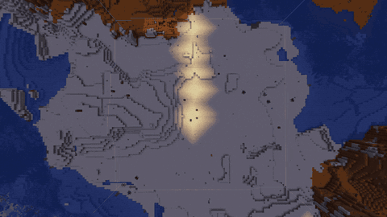
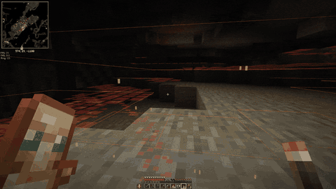
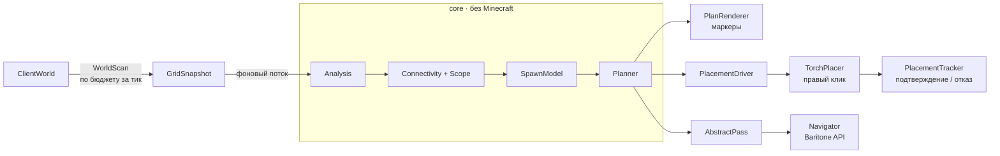

<div align="center">

[English](README.md) | **Русский**

# 🔥 Torch Automation

**Осветите свою территорию — и забудьте, откуда взялся очередной крипер.**

Бесплатный аддон для [Meteor Client](https://meteorclient.com) на Minecraft **1.21.1**. Он сам вычисляет, *где именно* нужны факелы, чтобы в темноте не появлялись мобы, и сам их ставит.


### [⬇️ Скачать последнюю версию](https://github.com/ZederBreys/AdentikaTorch/releases/latest)



<sub>«Факелы вокруг меня»: запустили, отошли в сторону — и вся территория освещена ровно, без дыр и лишних факелов.</sub>

</div>

---

## Зачем это нужно?

Если ставить факелы сеткой, уходит целый стак, а тёмные углы всё равно остаются. Torch Automation действует наоборот: он читает настоящий свет в мире, находит каждый блок, где действительно может появиться монстр, и рассчитывает **наименьшее число факелов, которое закроет их все**.

- 💡 **Учитывает свет, который уже есть.** Лампы, лава, ваши старые факелы — всё идёт в расчёт. Факел не будет поставлен туда, где и так всё освещено.
- 🍃 **Не тратит факелы на блоки, где мобы не появляются.** Листва, стекло, плиты, ковры и похожие блоки остаются в покое. Решают это собственные проверки появления мобов из игры, а не заранее заданный список.
- 🧠 **Понимает, где вы находитесь.** На поверхности освещает землю вокруг. Под землёй сам переходит в пещерный режим: держится вашей пещеры, смотрит выше и ниже и предпочитает ставить факелы на стены.
- 🧱 **Ставит на любую подходящую поверхность.** Пол, стены, печки, верстаки, бочки… На блоках, которые открываются по клику, мод приседает, чтобы не открылось меню.
- 🕳️ **Не трогает закрытые шахты.** Учитываются только места, связанные с вами по воздуху, поэтому замурованный тоннель под ногами факелов не получит.
- ✋ **Действует честно.** Каждый факел ставится обычным правым кликом, только на расстоянии вытянутой руки и в прямой видимости. Для строгих серверов есть медленный режим *Legit*.
- 👀 **Всё происходящее видно.** Тёмные места, план факелов и следующая цель отрисованы прямо в мире. Прогресс отображается в чате и в списке модулей.
- ⏯️ **Всё под вашим контролем.** Ничего не запускается само. Пауза, продолжение или отмена — в любой момент. Прогресс сохраняется, и длинная задача продолжится после перезапуска игры.

## Пять способов осветить мир

| Модуль | Что делает |
|---|---|
| 🌍 **Факелы вокруг меня** `torch-around` | Освещает территорию вокруг вас без всякого выделения. Мод ходит с помощью Baritone и ставит факелы, пока всё в радиусе не будет освещено: по умолчанию 42 блока, максимум 200. Работает и в пещерах. |
| ⛏️ **Сопровождение** `torch-escort` | Вы исследуете, а мод ставит факелы по пути. Создан для шахт и пещер. |
| 📐 **Автопроход** `torch-pass` | Выделите область — мод обойдёт её участок за участком, пока она не будет освещена полностью. По умолчанию — до 512 × 512 (`max-size`). |
| 🔍 **Подсветка** `torch-highlight` | Показывает тёмные места, чанки с тёмными местами и рекомендуемые позиции факелов. Ничего не ставит. |
| 🗺️ **Область** `torch-area` | Выделите область двумя кликами и узнайте, сколько факелов ей нужно и хватит ли тех, что у вас с собой. |

## ⛏️ Сопровождение — больше никакой копки в темноте

Включите и просто копайте дальше. Сопровождение освещает тоннель вокруг вас на ходу: каждый факел встаёт ровно туда, где нужен, только в пределах досягаемости, а камера потом возвращается обратно, так что вы почти этого не замечаете.

<div align="center">

</div>

Красные квадраты — места, где могут появиться монстры. Видно, как они исчезают, когда ставятся факелы.

## 🌐 Говорит на вашем языке

Все сообщения в чате доступны:

- 🇬🇧 **English**
- 🇷🇺 **на русском**

Язык выбирается автоматически по языку Minecraft.

## 🚀 Быстрый старт

**Понадобится:** Minecraft Java **1.21.1** с [Fabric Loader](https://fabricmc.net/use/), **[Meteor Client 0.5.8](https://meteorclient.com)** и **Baritone** для режимов с ходьбой («Факелы вокруг меня» и «Автопроход»).

1. Скачайте `torch-automation-<версия>.jar` из [последнего релиза](https://github.com/ZederBreys/AdentikaTorch/releases/latest) или [соберите сами](#сборка).
2. Положите его в папку `mods` рядом с Meteor Client.
3. Откройте меню Meteor (**правый Shift**). Модули находятся в категории **Torch**.
4. Положите факелы в хотбар или во вторую руку, затем включите модуль или введите команду:

```
.torcharound start        осветить всё вокруг вас (радиус 42)
.torcharound start 80     ...или задать свой радиус
.torcharound preview      сначала показать границу области
.torcharea start          обойти выделенную область
```

> [!NOTE]
> Факелы предотвращают появление мобов **из-за темноты** в Overworld. Они не действуют на спавнеры, особые структуры (например, подводные храмы, крепости Нижнего мира или хижины ведьм), патрули разбойников и мобов, которые пришли из неосвещённых мест. Слизням в болотах нужно больше света (профиль `SWAMP_SLIMES`).

> [!WARNING]
> Многие сервера запрещают автоматизацию. Используйте мод только там, где это разрешено.

---

# 🛠️ Техническая документация

Дальше — для разработчиков и любопытных игроков: как аддон устроен внутри.

- [Архитектура](#архитектура)
- [Структура проекта](#структура-проекта)
- [Конвейер анализа](#конвейер-анализа)
- [Модель спавна и света](#модель-спавна-и-света)
- [Планировщик факелов](#планировщик-факелов)
- [Поверхность или пещера](#поверхность-или-пещера)
- [Куда можно поставить факел](#куда-можно-поставить-факел)
- [Установка факелов: сопровождение и драйвер установки](#установка-факелов-сопровождение-и-драйвер-установки)
- [Автопроходы: «Автопроход» и «Факелы вокруг меня»](#автопроходы-автопроход-и-факелы-вокруг-меня)
- [Правила блоков](#правила-блоков)
- [Локализация](#локализация)
- [Команды и настройки](#команды-и-настройки)
- [Сборка](#сборка)
- [Выпуск релиза](#выпуск-релиза)

## Архитектура

Проект состоит из двух Gradle-модулей:

- **`core`** — чистая Java 21 **без классов Minecraft**: симуляция света, модель спавна, планировщик, связность, разбиение на участки и правила блоков. Полностью покрыт unit-тестами JUnit 5 и не зависит от версии игры.
- **Аддон** (`src/main`) — тонкий слой адаптеров. Он читает мир в `GridSnapshot`, запускает ядро, отрисовывает результат, кликает и управляет Baritone.



Код, который зависит от конкретной версии Minecraft, собран в `mc/`: с игрой работают `WorldScan`, `TraitsProvider` и `TorchPlacer`, а `Navigator` — единственный класс, который импортирует Baritone. Если Baritone не установлен, режимы с ходьбой сообщают об этом, а всё остальное продолжает работать.

## Структура проекта

```
core/src/main/java/adentika/torch/core/
  GridSnapshot      компактный кусок мира: флаги, свет блоков, непрозрачность, излучение, грани
  LightSim          распространение света блоков по правилам движка 1.21.1
  SpawnModel        тёмные места спавна для профиля света
  Scope             границы анализа: коробка/окно, связность по воздуху, макс. глубина
  Connectivity      заливка по воздуху от одной или нескольких точек
  Planner           жадный планировщик факелов (покрытие множеств)
  PlacementTracker  учёт кликов: подтверждён / отклонён
  TileGrid          участки 16×16, состояния, порядок обхода, сохранение
  blocks/           BlockTraits, Category, CategoryResolver, Hazard
src/main/java/adentika/torch/
  TorchAutomationAddon   точка входа Meteor: категория, модули, команды
  mc/       WorldScan, TraitsProvider, BlockRules, Analysis, PlanRenderer,
            TorchPlacer, PlacementDriver, Navigator, PassStore, Msg
  modules/  TorchHighlight, TorchArea, TorchEscort, AbstractPass,
            TorchPass, TorchAround, TorchBlocks
  commands/ .torcharea, .torcharound, .torchblock
src/main/resources/assets/torch-automation/lang/   en_us.json, ru_ru.json
docs/       концепция, исследование, решения, план, правила блоков, ручные тесты
```

## Конвейер анализа

1. **Скан** (`WorldScan`, главный поток). Заполняет `GridSnapshot` клетка за клеткой в рамках бюджета времени: по умолчанию 3 мс за клиентский тик (`budget-ms`). Поэтому даже большая область не подвешивает игру. Незагруженные чанки помечаются как `UNKNOWN`. Неизвестные клетки никогда не считаются безопасными и не пропускают свет.
2. **Анализ** (`Analysis`, один фоновый поток). Строит `Scope`, находит тёмные места спавна (`SpawnModel`) и планирует факелы (`Planner`). Заодно группирует тёмные места по чанкам для подсветки чанков.
3. **Показ и действие.** `PlanRenderer` рисует места, чанки и маркеры факелов. Режимы установки передают план в `PlacementDriver`.

Подсветка пересканирует область, когда вы отошли на `rescan-distance` блоков, когда изменился блок внутри снимка и каждые `refresh-seconds` секунд, потому что свет может меняться и без обновления блоков. Рекомендации прошлого плана, которые ещё полезны и лежат внутри области, сохраняются. Поэтому маркеры не прыгают, пока вы идёте.

## Модель спавна и света

- **Безопасно = свет блоков ≥ 1** в клетке ног моба (профиль `MONSTERS`). В Overworld в 1.21.1 любой свет блоков не даёт враждебным мобам пройти проверку на темноту. Свет неба никогда не считается защитой: его меняют ночь и погода. Есть ещё два профиля: `SWAMP_SLIMES` (≥ 8) и `PATROLS` (≥ 9).
- **Может ли здесь появиться моб?** Отвечают ванильные методы, а не список блоков:
  - `SpawnRestriction.isSpawnPosAllowed` проверяет пол и правила размещения;
  - `isSpaceEmpty(type.getSpawnBox(...))` проверяет хитбокс.

  Используются три пробы с разными хитбоксами: зомби, паук и эндермен.
- **Биомы.** В Грибных полях и Глубокой тьме монстры естественно не появляются. Клиент получает биомы без списков спавна, поэтому эти два биома распознаются по ключу. Включить их можно настройкой `include-no-monster-biomes`.
- **Симуляция света** (`LightSim`) повторяет `ChunkBlockLightProvider`. Шаг в соседнюю клетку стоит `max(1, непрозрачность)`. Шаг невозможен, если полна грань источника или соседа, которая перекрывает свет. Так учитываются плиты, ступени и похожие блоки.
- **Ненадёжный свет.** Свет источников, которые могут погаснуть (печи, лампы, свечи, костры…), по умолчанию не считается защитой (`distrust-variable-light`). В этом случае свет пересчитывается только от стабильных источников.

## Планировщик факелов

`Planner` — детерминированное **жадное покрытие множеств**:

1. Каждая клетка, где может стоять факел, — кандидат. Его *покрытие* — тёмные клетки, которые его собственный свет (уровень 14) поднимет до безопасного уровня. Уже освещённые клетки тёмными не считаются, поэтому факел рядом с существующим светом ничего не даёт и никогда не выбирается.
2. Независимо работают две эвристики:
   - **max-gain** — ленивая очередь с приоритетом, которая всегда берёт факел, покрывающий больше всего непокрытых клеток;
   - **rarest-first** — сначала клетка, которую может осветить меньше всего кандидатов; так лучше обрабатываются края и углы.
3. Каждый результат проходит **удаление лишних**: убираются факелы, все клетки которых уже покрыты другими. Побеждает план с меньшим числом факелов.
4. В пещерном режиме при равенстве выбирается настенный факел.

Результат близок к минимальному, но оптимальность не гарантирована. Тёмные клетки, до которых не дотянуться (крыши, уступы), выводятся как *неосвещаемые*. В режимах установки используются только кандидаты в пределах досягаемости с клетки, где можно стоять и которая связана с игроком по воздуху.

## Поверхность или пещера

- Высота поверхности колонки берётся из клиентской карты высот `MOTION_BLOCKING`. Оттуда идёт спуск вниз мимо листвы и блоков без коллизии (вода, трава, цветы).
- В режиме **Auto** вы *под землёй*, если ваши ноги хотя бы на `auto-cave-depth` блоков (по умолчанию 6) ниже этой поверхности. Режим пересчитывается при каждом скане, о переключении сообщается в чате.

| | Поверхность | Пещера |
|---|---|---|
| Окно по высоте | 6 вниз / 8 вверх | 24 вниз / 16 вверх |
| Макс. глубина от поверхности | 3 (`limit-depth`) | не ограничена |
| Связность с вами по воздуху | вкл. | вкл. |
| Предпочтение факелов | на пол | на стену |
| Baritone (режимы с ходьбой) | может ломать/ставить блоки, чтобы пройти | только ходит (`allow-digging-in-caves`) |

**Связность по воздуху** (`Connectivity`) — заливка по проходимым клеткам начиная с ваших ног. В анализ попадают только достигнутые клетки, поэтому замурованная шахта под ногами игнорируется.

## Куда можно поставить факел

Для каждой проходимой, заменяемой клетки без жидкости `WorldScan` спрашивает саму игру:

- **Факел на полу:** `Blocks.TORCH.canPlaceAt(...)`, и у блока снизу должен быть достаточно твёрдый центр верхней грани.
- **Факел на стене:** `Blocks.WALL_TORCH` в каждом горизонтальном направлении, проверка через `canPlaceAt(...)`. Опорная сторона должна быть полным твёрдым квадратом.

Затем опору фильтруют правила блоков (см. [Правила блоков](#правила-блоков)). Например, листва и строительные леса по умолчанию не используются, потому что могут исчезнуть. Песок и гравий разрешены, иначе пустыню было бы не осветить. Интерактивные блоки помечаются, чтобы перед кликом по ним мод приседал; `TraitsProvider.isInteractive` охватывает контейнеры, двери, рабочие станции и т.п.

## Установка факелов: сопровождение и драйвер установки

`TorchPlacer` делает один обычный клик:

- **Досягаемость.** Луч от глаз по *точному* направлению взгляда длиной `getBlockInteractionRange() − 0.1` должен попасть в опорную грань. Ничего не кликается дальше вытянутой руки или сквозь блоки.
- **Сначала поворот, потом клик.** Камера поворачивается в `TickEvent.Pre`, а клик происходит в `TickEvent.Post` через `interactionManager.interactBlock`. К этому моменту новое направление взгляда сервер уже получил.
- **Факелы** берутся только из хотбара или второй руки. Приседание включается только для интерактивных опор и потом отпускается, если вы сами не держите клавишу.

`PlacementDriver` выполняет клики в одном из двух режимов:

| Режим | Поведение |
|---|---|
| **Aggressive** (по умолчанию) | Несколько факелов подряд, клик раз в `fast-delay-ticks` тиков. Подтверждения проверяются параллельно. |
| **Legit** | По одному факелу: перед следующим ждёт ответа сервера и свежего скана. |

`PlacementTracker` считает клик лишь *запросом*. Факел засчитывается, только если он всё ещё стоит в мире после того, как сервер успел ответить. Место, отклонённое дважды, пропускается. После `max-failures` отказов подряд модуль останавливается и сообщает причину. Он также останавливается, когда кончились факелы, вы погибли или покинули Overworld.

**Сопровождение** использует план подсветки и при необходимости само её включает. Пока вы идёте, оно ставит запланированные факелы, оказавшиеся в зоне досягаемости, а затем возвращает камеру (`restore-view`).

## Автопроходы: «Автопроход» и «Факелы вокруг меня»

Оба модуля используют общий движок `AbstractPass`. Область делится на **участки 16 × 16**, и каждый участок проходит такие шаги:

```
PICK → LOAD (подойти, пока не загрузятся чанки) → SCAN (участок + 8 блоков запаса)
     → ANALYZE (план с достижимых связанных мест) → WORK → VERIFY (повторный скан) → готово
```

- **WORK** ставит всё, до чего можно дотянуться. Ко всему остальному `Navigator` отправляет Baritone к ближайшему оставшемуся факелу (`GoalNear`). Факел, который не удалось поставить и после повторного подхода, помечается недоступным и попадает в итог. На участок даётся до 3 циклов «план — проверка».
- **Порядок обхода** (`TileGrid.todoInWalkOrder`). Следующим берётся ближайший к вам участок среди граничащих с готовыми. Раньше идут участки, у которых больше закрытых сторон (готовый сосед или край области), поэтому за спиной не остаются дыры и полоски.
- **«Факелы вокруг меня»** фиксирует квадрат и окно по высоте в точке старта. Связность по воздуху переносится между участками через битовую карту на всю область: каждый новый участок заливается от клеток, до которых уже дошли соседи. Участок, который сначала выглядел пустым, открывается заново, если до него позже доходит извилистая пещера.
- **Baritone.** Если Baritone уже занят (`#mine`, `#goto`…), проход не запускается без `start force`. Когда копать запрещено, `allowBreak` и `allowPlace` отключаются на время прохода, а потом возвращаются к вашим значениям.
- **Прогресс** сохраняется для каждого мира или сервера и измерения в `.minecraft/meteor-client/torch-automation/passes.json`. Проход продолжается при следующем запуске. Для «Факелов вокруг меня» нужно стоять не дальше 8 блоков от прежней точки старта и указать тот же радиус.
- **Остановки** всегда с причиной: кончились факелы, повторные отказы, 3 неудачи поиска пути подряд, смерть, смена мира, уход из области или лимит факелов (`max-torches`). Клавиши движения проход **никогда** не ставят на паузу. Модули никогда не запускаются сами при входе в мир.

## Правила блоков

`CategoryResolver` складывает правила по слоям:

| Слой | Источник | Может ли игрок изменить? |
|---|---|---|
| L0/L4 | Механика игры и абсолютные ограничения (без факелов в жидкостях, никогда не заходить в лаву) | Нет |
| L1 | Определяется по свойствам блока (урон огнём, интерактивность, переменный свет) | Убрать |
| L2 | Умолчания мода (кактус, рыхлый снег, скалк, грядки, нажимные плиты, листва, леса…) | Убрать |
| L3 | Списки игрока в `torch-blocks` | Добавить / убрать |

Категории: *Опасные*, *Не кликать*, *Не трогать*, *Нестабильная опора*, *Последствия* и *Переменный свет*. Команда `.torchblock info` (наведитесь на блок или укажите его) объясняет, как классифицирован блок и почему.

## Локализация

Все тексты для игрока проходят через `mc/Msg` как ключи `Text.translatable` из `assets/torch-automation/lang/en_us.json` и `ru_ru.json`. Minecraft выбирает файл по языку игры, а если перевода нет — берёт английский. Повторяющиеся строки статуса используют один id сообщения в чате, поэтому обновляются на месте, а не засоряют чат. Названия модулей и настроек остаются на английском, потому что Meteor 0.5.8 использует их как ключи конфигурации.

## Команды и настройки

| Команда | Описание |
|---|---|
| `.torcharound start [радиус\|force]` | Запустить «Факелы вокруг меня» (радиус 8–200) |
| `.torcharound preview [радиус]` | Показать границу области на 10 с (также клавиша `preview-bind`) |
| `.torcharea pos1\|pos2 [x y z]` | Задать угол; `~` — относительная координата. Работает и средняя кнопка мыши. |
| `.torcharea start [force]` | Запустить «Автопроход» по выделению |
| `.torcharea` / `.torcharound` `pause \| resume \| cancel \| info` | Управление запущенным проходом (также клавиша `pause-bind`) |
| `.torcharea clear` | Сбросить выделение |
| `.torchblock info [блок]` | Объяснить, как классифицирован блок |

Самые полезные настройки:

- `radius` и `max-torches` («Факелы вокруг меня»);
- `mode` Auto / Surface / Cave;
- `placement-mode` Aggressive / Legit;
- `profile`;
- `prefer-wall-torches`;
- `include-no-monster-biomes`;
- `restrict-baritone` и `allow-digging-in-caves`;
- настройки цветов в группе **Render**.

## Сборка

Нужен **JDK 21**: Gradle 8.8 и Loom 1.7 не запускаются на более новых JDK.

```bash
./gradlew build          # аддон + тесты ядра
./gradlew :core:test     # только unit-тесты ядра
```

Результат — `build/libs/torch-automation-<версия>.jar`. В нём аддон и `core`; Meteor и Baritone не вкладываются. Baritone — зависимость только для компиляции (`meteordevelopment:baritone:1.21.1-SNAPSHOT`), игрок устанавливает его сам. Каждый push собирается и тестируется в GitHub Actions.

## Выпуск релиза

Релизы собирает и публикует GitHub Actions (`.github/workflows/release.yml`). Достаточно отправить тег версии:

```bash
git tag v1.0.0
git push origin v1.0.0
```

Дальше workflow делает следующее:

1. Проверяет, что тег вида `v1.2.3` (или `v1.2.3-beta.1` — такой публикуется как пре-релиз).
2. Берёт версию Java из `.java-version` и собирает `./gradlew build -Pmod_version=<тег без v>`. Версия — это тег.
3. Берёт готовый jar после переименования классов `build/libs/torch-automation-<версия>.jar`, а не `-dev`.
4. Проверяет, что в `fabric.mod.json` внутри jar указана эта версия и что классы `core` на месте.
5. Создаёт релиз с прикреплённым jar и списком коммитов с прошлого тега `v*`.

Публикация запускается только после успешной сборки, и только у неё есть право записи. Обычные push и pull request запускают лишь проверочную сборку (`build.yml`).

Проектные документы лежат в [`docs/`](docs):

- [концепция](docs/PRODUCT_SPEC.md)
- [исследование](docs/TECHNICAL_RESEARCH.md)
- [решения](docs/DECISIONS.md)
- [правила блоков](docs/BLOCK_CLASSIFICATION.md)
- [чек-лист ручных тестов](docs/MANUAL_TESTS.md)

---

## 📄 Лицензия

Torch Automation — свободное программное обеспечение под лицензией **GNU General Public License v3.0**. Его можно использовать, изучать, распространять и изменять. Если вы распространяете изменённую версию, она должна остаться под GPL-3.0 и сопровождаться исходным кодом. Полный текст — в файле [LICENSE](LICENSE).

Иконка аддона — временная заглушка из [meteor-addon-template](https://github.com/MeteorDevelopment/meteor-addon-template) (CC0).
